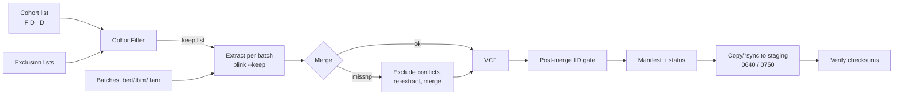

# Genomic Cohort Delivery Pipeline

[](https://github.com/dsugurtuna/genomic-cohort-delivery-pipeline/actions/workflows/ci.yml)


Assemble a research cohort from multi-batch PLINK 1.9 genotype data: remove excluded participants, merge batches, handle allele conflicts, write a checksum manifest, and copy the package to a staging area with verification.

> **Note:** Independent open-source reference implementation inspired by biobank-scale clinical genomics workflows. Built from scratch on synthetic data; contains no employer code, proprietary tooling, or real participant data.

**Where this fits:** part of a curated set of public clinical genomics and health-data reference architectures, alongside [hla-pipeline-manager](https://github.com/dsugurtuna/hla-pipeline-manager) (multi-batch SNP2HLA imputation orchestration and SHA-256 release verification) and [clinical-cohort-ai-platform](https://github.com/dsugurtuna/clinical-cohort-ai-platform) (clinical research platform reference architecture).

## The problem

A data release for a research project needs the approved participants, from genotype batches
typed at different times, in one file set, minus anyone who has withdrawn or failed QC. Batches
often disagree on a few variants' alleles, which makes a PLINK merge fail. The recipient then needs
to be able to check that what arrived is what was sent.

## What this does

1. **Filter** (`CohortFilter`): remove samples on exclusion lists from a cohort list. Supports CSV,
   TSV, and whitespace-delimited PLINK `FID IID` exclusion files, skips blank IDs, preserves lines
   intact for `--keep`, and records `excluded_iids` and removal reasons.
2. **Merge** (`GenotypeMerger`): extract the cohort from each batch (using collision-safe indexed
   intermediate prefixes), merge with `--merge-list`, and if PLINK writes a `-merge.missnp` file,
   exclude those variants from every batch and merge again. Excluded variants are listed in
   `MergeReport` and written to `CONFLICT_VARIANTS.txt` in the delivery package. Any other PLINK
   failure stops immediately with PLINK's own output. Converts the result to bgzipped VCF.
3. **Governance gate** (`DeliveryPipeline`): fails closed if `batch_prefixes` is empty, if the merged
   `.fam` is empty, or if any excluded or unrequested IID appears in the final merged `.fam`.
4. **Manifest** (`ManifestGenerator`): computes size, MD5, and SHA-256 for payload files and
   `STATUS_SUMMARY.tsv` (no unconditional `PASS` claim), writes `MANIFEST.tsv`, and provides
   `read_manifest()` + `verify()` so a recipient can verify a package on disk.
5. **Transfer** (`SecureTransfer`): copies top-level regular files via `copy` or `rsync` into a
   new dated staging directory with `0640`/`0750` permissions, cleans up partial staging directories
   on transfer failure, and verifies every file's checksums at the destination.
6. **CLI** (`cohort-delivery`): `cohort-delivery run` (from a JSON config and/or flags) and
   `cohort-delivery verify <dir>` to verify a delivered package against `MANIFEST.tsv`.

## Quickstart

```bash
git clone https://github.com/dsugurtuna/genomic-cohort-delivery-pipeline.git
cd genomic-cohort-delivery-pipeline
python -m venv .venv && source .venv/bin/activate
pip install -e ".[dev]"
pytest
python examples/demo.py
```

The demo runs the whole pipeline offline on synthetic batches, with
[`examples/fake_plink.py`](examples/fake_plink.py) standing in for PLINK (it mimics extraction,
merge conflicts and VCF conversion, nothing more). Output, checked by `tests/test_demo.py` (the
first line is a logged warning on stderr):

```text
Excluding 1 variants with conflicting alleles and re-merging.
Cohort: 10 samples; removed 2 {'Withdrawal': 1, 'SexMismatch': 1}
Merged: 8 samples, 3 variants
Excluded for allele conflicts: ['rs9300001']
Delivered 8 files; checksums verified: True
  CONFLICT_VARIANTS.txt
  DEMO01_final_genotypes.bed
  DEMO01_final_genotypes.bim
  DEMO01_final_genotypes.fam
  DEMO01_final_genotypes.log
  DEMO01_final_genotypes.vcf.gz
  MANIFEST.tsv
  STATUS_SUMMARY.tsv
```

`rs9300001` is A/G in one batch and T/C in the other (a strand flip), so it is excluded rather
than silently merged.

### With real data (needs PLINK 1.9 and rsync)

```python
from cohort_delivery import DeliveryPipeline, PipelineConfig

config = PipelineConfig(
    project_id="STUDY-A",
    cohort_file="cohort_all_samples.txt",
    exclusion_files=["exclusion_list_gender_mismatch.csv"],
    batch_prefixes=["batch_01", "batch_02", "batch_03"],
    work_dir="work/",
    delivery_dir="delivery/",
    staging_root="researcher_staging/",
)

pipeline = DeliveryPipeline()
result = pipeline.run(config)
print(f"Delivered {result.transfer_report.file_count} files")
```

Or via the CLI:

```bash
cohort-delivery run --config pipeline.json
cohort-delivery verify researcher_staging/STUDY-A_Delivery_20261127/
```

### Individual modules

```python
from cohort_delivery import CohortFilter, ManifestGenerator

# Filter a cohort
flt = CohortFilter()
report = flt.apply("cohort.txt", exclusion_paths=["exclusions.csv"], output_path="filtered.txt")
print(f"{report.original_count} -> {report.final_count} samples")

# Generate and verify a manifest on disk
gen = ManifestGenerator()
manifest = gen.generate("delivery/", project_id="STUDY-A")
gen.write_manifest(manifest, "delivery/MANIFEST.tsv")

loaded = gen.read_manifest("delivery/MANIFEST.tsv")
problems = gen.verify(loaded, "delivery/")
```

## How it works



## Design decisions

- **Exclude conflicting variants, and say so.** Flipping strands automatically is only safe for
  non-palindromic SNPs and needs a reference; getting it wrong silently corrupts genotypes.
  Excluding is conservative, and the excluded list goes into `CONFLICT_VARIANTS.txt` and the
  report.
- **Stop on any other PLINK failure.** Naive shell wrappers often ignore non-zero exits without a
  `.missnp` file and carry on with missing outputs. A delivery that half-worked is worse than one
  that stopped.
- **Match on IID, keep lines intact.** PLINK 1.9 `--keep` expects `FID IID`. Reducing lines to one
  column breaks the keep list and matches exclusions against family IDs.
- **Fail-closed post-merge consent check.** After PLINK merges the batches, the pipeline verifies
  that the output `.fam` is non-empty and contains zero excluded or unrequested participant IIDs.
- **No integrity verdict without a check.** Traditional batch summaries often write `PASS`
  unconditionally. Verification happens at the destination against `MANIFEST.tsv` (including
  `STATUS_SUMMARY.tsv`), and the result is reported by the code that ran it.
- **No access for "others" by default.** Genotype data should be readable by the owner and the
  project group only. Default system umasks often grant read access to every user on a shared host.
- **Never deliver into an existing directory.** Re-running on the same day must not mix two
  deliveries unless an explicit `delivery_tag` or `unique_run` timestamp is supplied.
- **Standard library only in the package.** PLINK and rsync do the heavy lifting; Python
  orchestrates, checks and records.

## Limitations and what this is not

- PLINK 1.9 only. PLINK 2 uses different merge and export commands.
- Conflicting variants are dropped, not repaired. A/T and C/G SNPs that are strand-flipped but look
  consistent are not detected; check strand against a reference before merging.
- No sample or variant QC. Inputs are assumed to be QC'd batches.
- "Transfer" is a local copy or rsync to a filesystem the pipeline can write to. External cross-organisation encryption (such as GPG or envelope encryption) is outside the scope of this package.
- Exclusions only work if the exclusion lists are complete and use the same IDs as the genotype
  files. The pipeline enforces post-merge disjointness against every provided exclusion list and
  checks requested against delivered sample counts, but cannot know about a withdrawal that is not
  on a list.

## Roadmap

- Strand check against a reference panel before merging, with automatic flipping only for
  non-ambiguous SNPs.

## Development

```bash
make dev     # install with dev dependencies
make check   # ruff lint and format check, mypy, pytest
```

See [docs/WHY.md](docs/WHY.md) for the reasoning behind the design, and
[CONTRIBUTING.md](CONTRIBUTING.md) to contribute.

## Licence

MIT. See [LICENSE](LICENSE).

---

Personal project by [Ugur Tuna](https://github.com/dsugurtuna). Not affiliated with or endorsed by any employer.
